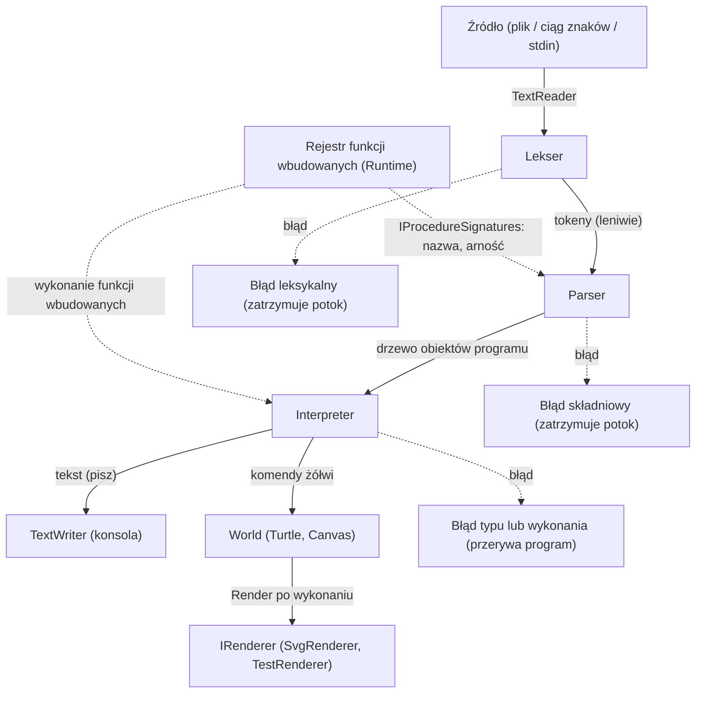

# BAZA JĘZYKA

## Podstawa języka
Parę decyzji projektowych:
1. będziemy mieć tylko 4 podstawowe typy: liczba, tekst, zmienna logiczna oraz żółw.
2. będziemy mieć typowanie dynamiczne i silne 
3. Przeciążenie :
   To zabroni posiadać różnych funkcji o tej samej nazwie ale innej ilości argumentów. ( co uprości język ). Druga definicja procedury o tej samej nazwie będzie zwracać błąd. Jednakże próba zapisu innej zmiennej o tej samej nazwie spowoduje tylko zmianę jej wartości ( bądź typu i wartości). 

EBNF podstawa:

```
program                 = { definicja_procedury }, główny_blok;
główny_blok             = "start", blok;
definicja_procedury     = "oto" , identyfikator , lista_parametrów , blok ;
lista_parametrów        = "(", [identyfikator , { ",", identyfikator } ], ")" ;
instrukcja              = przypisanie
						| instrukcja_warunkowa
						| pętla_powtórz
						| instrukcja_żółwia
						| powrót
						| wywołanie ;
						
przypisanie             = dostęp_do_pamięci, "<-", wyrażenie ;
dostęp_do_pamięci       = identyfikator , { "[", wyrażenie, "]" };

instrukcja_warunkowa    = "jeżeli" , "(" , wyrażenie, ")" , blok , [ "inaczej" , ( blok | instrukcja_warunkowa ) ] ;
pętla_powtórz           = "powtórz" ,  "(" , wyrażenie, ")" , blok ;

instrukcja_żółwia       = "nowy_żółw" , wyrażenie 
						| "żółw" , "(" , wyrażenie , ")" , "." , identyfikator , "(" , [ lista_argumentów ] , ")" 
						| "żółw" , "(" , wyrażenie , ")" , "." , "Run" , "(" , ")" , blok ;

powrót                  = "wynik" , wyrażenie ;
blok                    = "{" , { instrukcja } , "}" ;
lista_argumentów        = wyrażenie , { "," , wyrażenie } ;
```

```
wyrażenie               = alternatywa ;
alternatywa             = koniunkcja , { "lub" , koniunkcja } ;
koniunkcja              = negacja , { "oraz" , negacja } ;
negacja                 = ["nie"], porównanie ;
porównanie              = suma , [ operator_porównania , suma ] ;
suma                    = iloczyn , { ( "+" | "-" ) , iloczyn } ;
iloczyn                 = jednoargumentowy , { ( "*" | "/" | "%" ) , jednoargumentowy } ;
jednoargumentowy        = ["-"] , czynnik ;

czynnik                 = liczba
						| tekst
						| tekst_interpolowany
						| "prawda" | "fałsz"
						| dostęp_do_pamięci
						| wywołanie
						| "(" , wyrażenie , ")" ;

wywołanie               = identyfikator , "(" , [ lista_argumentów ], ")";

operator_porównania     = "=" | "<>" | "<" | ">" | "<=" | ">=" ;
```

```
litera                  = (* a-z, A-Z, ą ć ę ł ń ó ś ź ż oraz wielkie odpowiedniki *) ;
cyfra                   = "0" | "1" | "2" | "3" | "4" | "5" | "6" | "7" | "8" | "9" ;
identyfikator           = litera , { litera | cyfra | "_" } ; (* poza słowami zastrzeżonymi *)
zmienna                 = identyfikator ;
liczba                  = cyfra , { cyfra } , [ "." , cyfra , { cyfra } ] ;
znak_tekstu             = (* dowolny znak oprócz '"' i '\' *) ;
znak_interpolowany      = (* dowolny znak oprócz '"', '\', '{' i '}' *) ;
ucieczka                = "\" , ( '"' | "\" | "n" | "t" | "{" | "}" ) ;
tekst                   = '"' , { znak_tekstu | ucieczka } , '"' ;
tekst_interpolowany     = '$"' , { znak_interpolowany | ucieczka | "{" , wyrażenie , "}" } , '"' ;

komentarz               = "#" , { (* dowolny znak oprócz '#' *) } , "#" ;
biały_znak              = " " | "\t" | "\n" | "\r" ;
```
Nie potrzebne do gramatyki, ale nadal użyteczne:
```
słowo_zastrzeżone = "start", "oto", "już", "jeżeli", "inaczej", "powtórz", "wy", "lub", "oraz", "nie", "prawda", "fałsz", "nowy_żółw", "żółw",  "Run" 
```

#podpowiedź : wowałanie najlepiej aby było słownikiem w implementacji aby mieć wszystkie te funkcje wbudowane

Uwaga do powtórz:
```
powtórz ( <wyrażenie> ) { <instrukcje> }
```
- Wyrażenie jest obliczane raz, przed pierwszym obiegiem (zmiana :n w ciele
  nie zmienia liczby obiegów).
- Wartość musi być liczbą całkowitą nieujemną. 0 oznacza brak obiegów.
- `wy` w ciele pętli kończy całą procedurę.

przykładowe błędy:
```
Błąd typu (linia 6, kol. 9): 'powtórz' oczekuje liczby, otrzymano tekst.
Błąd wykonania (linia 6, kol. 9): liczba powtórzeń musi być nieujemną liczbą całkowitą, otrzymano 2.5.
```

## Funkcje

### Funkcje typu void

Składnia:
```
oto <nazwa_procedury> (<parametry>) { ... <instrukcje> ... }
```

Przykład:
```
oto kwadrat() {powtórz(4) { np(40) pw(90) } }
```
Odwołanie do zmiennej:
```
oto gwiazda(n) {powtórz(5) {np(n) pw(144)} }
```

### Funkcje zwracające wartość

Przykład:
```
oto pole (x)
{
	wynik x * x
}
```
`wynik` -> mówi, że zwraca wartość jakąś (wynik)

przykład z funkcją:
```
oto silnia (n)
{
  jeżeli (n <= 1)
  {
  	   wynik 1 
  }
  wynik n * silnia(n - 1)
}
```

## Typy danych
Robimy typowanie dynamiczne i silne. Jeden zapis `<-` do tworzenia i zmiany zmiennej. 
### Przypisanie wartości
Składnia:
```
<dostęp_do_pamięci> <- <wyrażenie>
```
UWAGA: tutaj ważne, że między znakami `<` oraz `-` nie ma spacji 
przykłady:
```
jeżeli :x < -10 { ... }       # porównanie (spacja między < a -)#
jeżeli :x < (-10) { ... }     # też porównanie#
jeżeli :x<-10 { ... }         # błąd, nie porównanie#
```
błąd postaci:
```
Błąd składni (linia 3, kol. 9): nieoczekiwane '<-' w wyrażeniu.
Czy chodziło o porównanie z liczbą ujemną? Napisz 'x < -10' (ze spacją).
```
### Rodzaje typów 

możliwe typy:
- liczba -> liczba zmienno przecinkowa ( nie ma rozróżnienia w logomocji )
- tekst -> string 
- logiczna -> bool 
- żółw -> ( mój żółw ) 
- tablica -> array #dodatek_jak_bedzie_czas

Powody dlaczego pod powierzchnią liczby będzie double:
- Jedyny typ liczbowy to liczba zmiennoprzecinkowa 64-bitowa (IEEE 754, `double`). Nie ma osobnych liczb całkowitych.
- Literał to cyfry z opcjonalną częścią ułamkową (`5`, `2.5`), bez znaku i bez zapisu wykładniczego. Minus jest operatorem.
- Zakres to ok. ±1.8 × 10^308. Liczby całkowite są dokładne do 2^53 (9 007 199 254 740 992), większe mogą być zaokrąglane.
- Limit leksera (parametr): maksymalna długość literału (domyślnie 64 znaki). Dłuższy literał albo literał o wartości poza zakresem to błąd leksykalny.
- Dzielenie przez zero (`/`, `%`) oraz wynik nieskończony lub NaN to błąd wykonania.
- `=` i `<>` porównują dokładnie, więc `0.1 + 0.2 = 0.3` daje `fałsz`.
- W interpolacji liczba ma najkrótszy zapis odtwarzający wartość, z kropką dziesiętną i bez `.0` dla całkowitych (`5`, `2.5`).

przykładowe błędy:
```
Błąd leksykalny (linia 2, kol. 5): literał liczbowy ma 70 znaków, limit wynosi 64.
Błąd wykonania (linia 8, kol. 3): dzielenie przez zero.
Błąd wykonania (linia 9, kol. 10): przepełnienie arytmetyczne (wynik poza zakresem liczby).
```
### Odwołanie do zmiennej
Składnia
```
x <- 100
np(x)
```

## Operatory

| Poz. | Operatory                                 | Operandy                                                      | Łączność     |
| ---- | ----------------------------------------- | ------------------------------------------------------------- | ------------ |
| 1    | `lub`                                     | logiczne                                                      | lewostronna  |
| 2    | `oraz`                                    | logiczne                                                      | lewostronna  |
| 3    | `nie` (jednoargumentowy)                  | logiczna                                                      | prawostronna |
| 4    | `=` `<>` `<` `>` `<=` `>=`                | dwa takie same typy (`<` `>` `<=` `>=` tylko liczby i teksty) | niełączne    |
| 5    | `+` `-`                                   | liczby; `+` także tekst + tekst (konkatenacja)                | lewostronna  |
| 6    | `*` `/` `%`                               | liczby                                                        | lewostronna  |
| 7    | `-` (jednoargumentowy)                    | liczba                                                        | prawostronna |
| 8    | nawiasy, literały, `x`, wywołania, `x[i]` |                                                               |              |
tutaj uwaga: nie będzie operatora `==` Jest to zmiana, którą uważam, za słuszną, ponieważ jest to mylące dla wielu programistów na samym początku ich kariery. 
Tabela jest uporządkowana od najniższego do najwyższego priorytetu:
operator z wyższą pozycją wiąże mocniej.
### Priorytety i nawiasy
`oraz` wiąże mocniej niż `lub` (jak mnożenie i dodawanie), a porównania
mocniej niż `oraz`. Nawiasy `( )` zmieniają kolejność obliczania.

```
x > 1 oraz x < 0 lub y > 0 oraz y < -1
```
czyli
```
((x > 1) oraz (x < 0)) lub ((y > 0) oraz (y < -1))
```

```
a lub b oraz c      ->  a lub (b oraz c)
(a lub b) oraz c    ->  nawiasy zmieniają kolejność
nie a = b        ->  nie (a = b)
```

Operatory `oraz` oraz `lub` są obliczane leniwie: od lewej do prawej,
obliczanie kończy się, gdy wynik jest już znany.

Przykłady: 

| Wejście            | Drzewo                      |
| ------------------ | --------------------------- |
| `a lub b oraz c`   | `a lub (b oraz c)`          |
| `a oraz b lub c`   | `(a oraz b) lub c`          |
| `a oraz b oraz c`  | `(a oraz b) oraz c`         |
| `nie a oraz b`     | `(nie a) oraz b`            |
| `nie a = b`        | `nie (a = b)`               |
| `(a lub b) oraz c` | nawiasy zmieniają kolejność |

EBNF:
```
wyrażenie               = alternatywa ;
alternatywa             = koniunkcja , { "lub" , koniunkcja } ;
koniunkcja              = negacja , { "oraz" , negacja } ;
negacja                 = ["nie"], porównanie ;
porównanie              = suma , [ operator_porównania , suma ] ;
suma                    = iloczyn , { ( "+" | "-" ) , iloczyn } ;
iloczyn                 = jednoargumentowy , { ( "*" | "/" | "%" ) , jednoargumentowy } ;
jednoargumentowy        = ["-"] , czynnik ;

czynnik                 = liczba
						| tekst
						| tekst_interpolowany
						| "prawda" | "fałsz"
						| dostęp_do_pamięci
						| wywołanie
						| "(" , wyrażenie , ")" ;

wywołanie               = identyfikator , "(" , [ lista_argumentów ], ")";

operator_porównania     = "=" | "<>" | "<" | ">" | "<=" | ">=" ;
```

- Arność procedury użytkownika to liczba parametrów w nagłówku `oto`, arność funkcji wbudowanych pochodzi z rejestru. Oba rodzaje wywołuje się tak samo. 
- Procedura musi być zdefiniowana przed użyciem (rekurencja jest dozwolona). 
- Argument to wyrażenie arytmetyczne lub tekstowe (`suma`); wartość logiczną podajemy w nawiasach: f (:a = :b). 
- Liczby, teksty i wartości logiczne są przekazywane przez wartość, tablice przez referencję. 
- Jako instrukcja: zwrócona wartość jest odrzucana. W wyrażeniu: procedura musi zwrócić wartość przez `wy`.
- Funkcje wbudowane (ruch żółwia, `pisz` itd.) są zwykłymi wywołaniami, gramatyka ich nie wyróżnia

Przykładowe błędy:
```
Błąd składni (linia 3, kol. 5): nieznana procedura 'kwadrat2'.
Błąd składni (linia 4, kol. 10): 'f' wymaga 2 argumentów, podano 1.
Błąd wykonania (linia 7, kol. 12): procedura 'kwadrat' nie zwróciła wartości.
```
## If-ologia

Pisanie operacji warunkowych:
```
jeżeli (<warunek>) {<instrukcje>}

jeżeli (<warunek>) {<instrukcje>} inaczej {<instrukcje>}

jeżeli (<warunek>) {<instrukcje>} 
inaczej jeżeli (<warunek>) {<instrukcje>}
inaczej {<instrukcje>}

jeżeli (<warunek> oraz <warunek>) {<instrukcje>}
```

## Komentarze + Terminale
- Komentarz zaczyna się od `#`, a kończy na następnym `#`. Może obejmować kilka linii.
- Nie można ich zagnieżdżać (pierwszy `#` po otwarciu zamyka komentarz).
- `#` wewnątrz tekstu w cudzysłowie nie jest komentarzem.
- Lekser pomija komentarz i nie zwraca tokenu. 

jeżeli na koniec pliku będzie niezamknięty komentarz to dostajemy błąd:
```
Błąd leksykalny (linia 4, kol. 3): niezamknięty komentarz rozpoczęty tutaj, brakuje zamykającego '#'.
```

Teraz posiadamy już wszystko aby napisać terminale do składni języka EBNF:
```
litera                  = (* a-z, A-Z, ą ć ę ł ń ó ś ź ż oraz wielkie odpowiedniki *) ;
cyfra                   = "0" | "1" | "2" | "3" | "4" | "5" | "6" | "7" | "8" | "9" ;
identyfikator           = litera , { litera | cyfra | "_" } ; (* poza słowami zastrzeżonymi *)
zmienna                 = identyfikator ;
liczba                  = cyfra , { cyfra } , [ "." , cyfra , { cyfra } ] ;
znak_tekstu             = (* dowolny znak oprócz '"' i '\' *) ;
znak_interpolowany      = (* dowolny znak oprócz '"', '\', '{' i '}' *) ;
ucieczka                = "\" , ( '"' | "\" | "n" | "t" | "{" | "}" ) ;
tekst                   = '"' , { znak_tekstu | ucieczka } , '"' ;
tekst_interpolowany     = '$"' , { znak_interpolowany | ucieczka | "{" , wyrażenie , "}" } , '"' ;

komentarz               = "#" , { (* dowolny znak oprócz '#' *) } , "#" ;
biały_znak              = " " | "\t" | "\n" | "\r" ;
```

## Operacje żółwia ( identyfikatory w EBNF)
Zostały same operacje żółwia. Tutaj podzielimy je na operacje związane z żółwiem oraz na niezwiązane z żółwiem. Jeżeli nie będzie zadeklarowany żółw przed operacją to będzie ją wykonywał podstawowy żółw "logi":

| Funkcja                         | Arg. | Typy               | Działanie (Core)                                                   |
| ------------------------------- | ---- | ------------------ | ------------------------------------------------------------------ |
| `naprzód` (`np`)                | 1    | liczba             | `Forward(d)`; ujemna wartość cofa żółwia bez zmiany kierunku       |
| `prawo` (`pw`)                  | 1    | liczba             | `Right(stopnie)`                                                   |
| `lewo` (`lw`)                   | 1    | liczba             | `Left(stopnie)`                                                    |
| `idź_do`                        | 2    | liczba x, liczba y | `SetPosition`, rysuje linię, gdy pisak opuszczony                  |
| `ustaw_kierunek`                | 1    | liczba             | `SetHeading` (0 = góra, rośnie zgodnie z ruchem wskazówek zegara)  |
| `środek`                        | 0    | –                  | `Home()`: do (0,0), kierunek 0, rysuje linię, gdy pisak opuszczony |
| `podnieś_pisak` / `opuść_pisak` | 0    | –                  | `IsPenDown = false` / `true`                                       |
| `kolor_pisaka`                  | 3    | liczby r, g, b     | `PenColor`                                                         |
| `kolor_wypełnienia`             | 3    | liczby r, g, b     | `FillColor`                                                        |
| `grubość`                       | 1    | liczba > 0         | `PenSize`                                                          |
| `ukryj_żółwia` / `pokaż_żółwia` | 0    | –                  | `IsVisible`                                                        |
| `okrąg`                         | 1    | liczba > 0         | `Circle(r)`, środek w bieżącej pozycji, kolor i grubość pisaka     |
| `początek_wypełnienia`          | 0    | –                  | `BeginFill()`                                                      |
| `koniec_wypełnienia`            | 0    | –                  | `EndFill()`, wielokąt powstaje przy co najmniej 3 punktach         |
| `poz_x`, `poz_y`, `kierunek`    | 0    | –                  | zwracają liczbę: `Pos.X`, `Pos.Y`, `Heading`                       |

Niezależne operacje od aktywnego żółwia:

| Funkcja       | Arg. | Typy           | Działanie                                                      |
| ------------- | ---- | -------------- | -------------------------------------------------------------- |
| `nowy_żółw`   | 1    | tekst          | `World.CreateTurtle(nazwa)`, duplikat to błąd                  |
| `usuń_żółwia` | 1    | tekst          | `RemoveTurtle(nazwa, keepDrawings: true)`, brak żółwia to błąd |
| `wyczyść`     | 0    | –              | `Canvas.Clear()`                                               |
| `kolor_tła`   | 3    | liczby r, g, b | `Canvas.Background`                                            |
| `pisz`        | 1    | tekst          | wypisuje wartość w osobnej linii na wyjście programu           |
| `liczba`      | 1    | tekst          | zamienia na liczbę, błąd, gdy tekst nie jest liczbą            |

### Wypisywanie zmiennych 
Przykład:
```
x <- 5
pisz($"x = {x}") # x = 5 #
pisz($"suma: {x + 1}, parzyste: {x % 2 = 0}") # suma: 6, parzyste: fałsz #
pisz("koniec")
```
dla 
```
pisz($"{x}")
```
zwracany jest błąd:
```
  Błąd typu (linia 3, kol. 6): 'pisz' oczekuje tekstu, otrzymano liczba. Użyj pisz($"{x}").
```

## Zasięg zmiennych 
- Program główny ma zmienne globalne, a każde wywołanie procedury ma własne zmienne lokalne.
- Procedura widzi tylko swoje parametry i zmienne lokalne. Nie widzi zmiennych globalnych ani zmiennych wywołującego, więc dane przekazujemy przez parametry.
- `x <- wartość` zmienia zmienną o tej nazwie w bieżącym zasięgu, a jeśli jej nie ma, tworzy ją.
- Parametry są zmiennymi lokalnymi i można je zmieniać. Dla liczb, tekstów i wartości logicznych nie wpływa to na wywołującego, a tablice są współdzielone (referencja).
- Blok `{ }` nie tworzy własnego zasięgu: zmienna utworzona w `jeżeli` lub `powtórz` żyje do końca procedury (albo programu).
- Przykrywanie zmiennych nie występuje: zmienna lokalna i globalna o tej samej nazwie są niezależne, bo procedura nie widzi globalnych.
- Odczyt zmiennej, która nie została wcześniej przypisana, to błąd wykonania.
- Zmienna i procedura mogą mieć tę samą nazwę, bo zmienną zawsze zapisujemy jako `x` albo `x <-`, a procedurę wywołujemy samą nazwą.

```
limit <- 10
oto f ()
{
	wynik limit
}
pisz $"{f}"
```
tutaj jest inny zasięg więc dostajemy błąd:
```
Błąd wykonania (linia 3, kol. 6): nieznana zmienna 'limit'.
```

## Białe znaki 
Spacje, tabulatory i nowe linie rozdzielają tokeny i poza tym nie mają znaczenia: poza tekstem w cudzysłowie i komentarzem są ignorowane. Instrukcje nie mają separatorów (ani średnika, ani końca linii jako końca instrukcji), więc `np 10 pw 90` i zapis w dwóch liniach znaczą to samo.

Jedyny wyjątek: `$"`, `<-`, `<=`, `<>` oraz `:x` są pojedynczymi tokenami i nie mogą mieć spacji w środku. Dlatego `x<-10`, `x <-10` i `x<- 10` są przypisaniami, a `x < -10` porównaniem.

## Konwertowanie typów
| z \ na   | liczba                | tekst                            | logiczna | tablica |
| -------- | --------------------- | -------------------------------- | -------- | ------- |
| liczba   | –                     | interpolacja `$"{x}"`            | brak     | brak    |
| tekst    | funkcja `liczba "12"` | –                                | brak     | brak    |
| logiczna | brak                  | interpolacja (`prawda`, `fałsz`) | –        | brak    |
| tablica  | brak                  | brak                             | brak     | –       |
"Brak" oznacza, że konwersji nie ma, a próba użycia takiej wartości w innym miejscu to błąd typu.

- Interpolacja jest jedyną konwersją na tekst. Liczba ma najkrótszy zapis odtwarzający wartość (`5`, `2.5`), wartość logiczna to `prawda` lub `fałsz`, tekst zostaje bez zmian.
- `liczba "<tekst>"` przyjmuje opcjonalny minus, cyfry i opcjonalną część ułamkową (`"12"`, `"-3.5"`). Wszystko inne (`""`, `" 5"`, `"1e3"`, `"abc"`) to błąd wykonania.
- Nie ma "prawdziwych" i "fałszywych" wartości: warunek musi być typu logiczna, `"5" + 1` to błąd typu, a `1 = "1"` to błąd typu (a nie `fałsz`).
- Parametry procedur nie mają typów. Błąd typu pojawia się dopiero przy użyciu wartości.
- Typy są sprawdzane w trakcie działania, więc błąd typu w nieobliczonym wyrażeniu (prawy operand `oraz` / `lub`, nieużyta gałąź `jeżeli`) nie jest zgłaszany.

Dozwolone typy operandów:

|Konstrukcja|Dozwolone typy|Wynik|Inne kombinacje|
|---|---|---|---|
|`+`|liczba + liczba, tekst + tekst|liczba, tekst|błąd typu|
|`-` `*` `/` `%`|liczba, liczba|liczba|błąd typu|
|`-` (jednoargumentowy)|liczba|liczba|błąd typu|
|`<` `>` `<=` `>=`|liczba, liczba albo tekst, tekst (teksty porównywane kodami znaków, bez wpływu ustawień regionalnych)|logiczna|błąd typu|
|`=` `<>`|dwie wartości tego samego typu: liczba, tekst albo logiczna|logiczna|różne typy lub tablice: błąd typu|
|`nie`|logiczna|logiczna|błąd typu|
|`oraz` `lub`|logiczna, logiczna (prawy operand tylko, gdy jest obliczany)|logiczna|błąd typu|
|warunek w `jeżeli`|logiczna|–|błąd typu|
|liczba powtórzeń w `powtórz`|liczba całkowita nieujemna|–|zły typ: błąd typu, zła wartość: błąd wykonania|
|nazwa w `żółw`|tekst|–|błąd typu|
|`t[i]`|`t`: tablica, `i`: liczba całkowita nieujemna|element|zły typ: błąd typu, zła wartość: błąd wykonania|
|`{ ... }` w interpolacji|liczba, tekst, logiczna|tekst|tablica: błąd typu|
|argumenty funkcji wbudowanych|według tabel funkcji|według tabel|błąd typu|

## Rodzaje błędów

Format komunikatu: `Błąd <rodzaj> (linia L, kol. K): opis`, a po nim opcjonalnie linia z podpowiedzią. Linie i kolumny są liczone od 1. Komunikaty trafiają na standardowe wyjście błędów, a `pisz` na standardowe wyjście.

| Rodzaj     | Zgłasza          | Co wykrywa                                                                                                                                                                                                                                                          | Co się dzieje                                      |
| ---------- | ---------------- | ------------------------------------------------------------------------------------------------------------------------------------------------------------------------------------------------------------------------------------------------------------------- | -------------------------------------------------- |
| leksykalny | lekser           | niezamknięty tekst lub komentarz, nieznany znak, zła sekwencja ucieczki, literał liczbowy ponad limit, identyfikator lub tekst ponad limit długości                                                                                                                 | zatrzymanie na pierwszym błędzie, bez uruchomienia |
| składniowy | parser           | zła struktura (brak `{`, `}`, `)`, ), `inaczej` bez `jeżeli`, `oto` w bloku, `wynik` poza procedurą, przekroczone zagnieżdżenie oraz kontrola nazw i arności: nieznana procedura, zła liczba argumentów, powtórzona definicja, nazwa wbudowana jako nazwa procedury | zatrzymanie na pierwszym błędzie, bez uruchomienia |
| typu       | interpreter      | operacja na wartości niewłaściwego typu                                                                                                                                                                                                                             | przerwanie programu w tym miejscu                  |
| wykonania  | interpreter      | dzielenie przez zero, przepełnienie, nieznana zmienna, indeks poza zakresem lub niecałkowity, procedura bez wartości, przekroczona głębokość wywołań, nieistniejący lub powtórzony żółw, kolor poza zakresem, tekst nie jest liczbą, zły rozmiar tablicy            | przerwanie programu w tym miejscu                  |
| wejścia    | uruchamiacz      | brak pliku, brak uprawnień do odczytu                                                                                                                                                                                                                               | komunikat, bez uruchomienia                        |
| wewnętrzny | najwyższy poziom | nieoczekiwany wyjątek w interpreterze (błąd w naszym kodzie)                                                                                                                                                                                                        | komunikat, to się nie powinno zdarzać              |

- Lekser i parser zatrzymują się na pierwszym błędzie. Kolejne błędy po pierwszym często są jego skutkiem, a dzięki temu implementacja jest prosta. Program jest najpierw w całości parsowany, więc przy błędzie leksykalnym lub składniowym nic się nie wykonuje.
- Przy błędzie typu lub wykonania wyjście `pisz` z wcześniejszej części programu zostaje, a rysunek wykonany do tej chwili pozostaje. Reszta programu się nie wykonuje, interpreter wypisuje komunikat i kończy się normalnie.
- Interpreter nigdy nie kończy się nieobsłużonym wyjątkiem. Każdy wyjątek jest łapany na najwyższym poziomie i zgłaszany jako błąd odpowiedniego rodzaju (nieoczekiwane jako `Błąd wewnętrzny`).
- Kod wyjścia: 0 oznacza powodzenie, 1 błąd w programie (leksykalny, składniowy, typu, wykonania), 2 błąd wejścia, 3 błąd wewnętrzny.

Przykłady:
```
Błąd leksykalny (linia 1, kol. 6): niezamknięty tekst rozpoczęty tutaj.
Błąd składni (linia 1, kol. 15): oczekiwano '{' po warunku 'jeżeli', napotkano 'np'.
Błąd typu (linia 1, kol. 8): warunek w 'jeżeli' musi być typu logiczna, otrzymano liczba.
Błąd wykonania (linia 2, kol. 11): dzielenie przez zero.
Błąd wejścia: nie można otworzyć pliku 'program.logo'.
```

## Słowa zastrzeżone i tokeny

### Słowa kluczowe (12)

Wielkość liter ma znaczenie (`Jeżeli` to zwykły identyfikator). Słów kluczowych nie można użyć jako nazwy zmiennej, parametru ani procedury.

| Grupa              | Słowa                                  |
| ------------------ | -------------------------------------- |
| definicje          | `oto`, `wynik`                         |
| sterowanie         | `jeżeli`, `inaczej`, `powtórz`, `żółw` |
| operatory logiczne | `oraz`, `lub`, `nie`                   |
| literały logiczne  | `prawda`, `fałsz`                      |

### Nazwy funkcji wbudowanych (30)

Nie można ich zdefiniować jako procedury (`oto np ...` to błąd składniowy). Mogą natomiast być nazwami zmiennych, bo zmienną zawsze zapisujemy jako `x` albo `x <-` (np. `liczba <- liczba "12"`).

```
naprzód np prawo pw lewo lw idź_do ustaw_kierunek środek
podnieś_pisak opuść_pisak kolor_pisaka kolor_wypełnienia grubość
ukryj_żółwia pokaż_żółwia okrąg początek_wypełnienia koniec_wypełnienia
poz_x poz_y kierunek nowy_żółw usuń_żółwia wyczyść kolor_tła pisz liczba
tablica rozmiar
```

### Tokeny rozróżniane przez lekser

| Token               | Przykłady                     | Wartość tokenu                |
| ------------------- | ----------------------------- | ----------------------------- |
| IDENTYFIKATOR       | `kwadrat`, `idź_do`           | nazwa                         |
| ZMIENNA             | `x`                           | -                             |
| LICZBA              | `5`, `2.5`                    | liczba (`double`)             |
| TEKST               | `"abc"`                       | tekst po rozwinięciu ucieczek |
| tekst interpolowany | `$"x = {x}"`                  | ciąg tokenów (patrz niżej)    |
| słowa kluczowe      | `oto`, `jeżeli`, ...          | 12 osobnych tokenów           |
| operatory           | `+ - * / % = <> < > <= >= <-` | –                             |
| separatory          | `( ) [ ] { }`                 | –                             |
| KONIEC              | koniec wejścia                | –                             |
Komentarze lekser pomija i nie zwraca dla nich tokenu. Każdy token ma pozycję (linia, kolumna).

Tekst interpolowany lekser zwraca jako ciąg tokenów: początek (`$"`), części tekstu, `{`, tokeny wyrażenia, `}`, dalsze części tekstu i koniec (`"`). Wewnątrz tekstu `{` zaczyna wyrażenie, a poza tekstem `{` i `}` to nawiasy bloku. Lekser trzyma licznik otwartych interpolacji, żeby wiedzieć, czy `}` kończy wyrażenie w tekście czy blok.
### Ograniczenia języka

- `wynik` poza procedurą to błąd składniowy.
- Wzajemna rekurencja nie jest możliwa, bo procedura musi być zdefiniowana przed użyciem (parser potrzebuje jej arności). Rekurencja bezpośrednia działa.

## Limity i zabezpieczenia

Interpreter wykonuje drzewo rekurencyjnie na stosie wywołań, więc nieograniczona rekurencja (np. `oto f() {f()} już`) zabiłaby cały proces. Dlatego głębokość jest ograniczona. Wszystkie limity są parametrami:

| Parametr                                     | Domyślnie | Zgłasza     | Rodzaj błędu |
| -------------------------------------------- | --------- | ----------- | ------------ |
| długość literału liczbowego                  | 64 znaki  | lekser      | leksykalny   |
| długość identyfikatora                       | 64 znaki  | lekser      | leksykalny   |
| długość tekstu                               | 10 000    | lekser      | leksykalny   |
| zagnieżdżenie (nawiasy, bloki, interpolacje) | 100       | parser      | składniowy   |
| głębokość wywołań procedur                   | 1000      | interpreter | wykonania    |
| rozmiar tablicy                              | 1 000 000 | interpreter | wykonania    |


```
Błąd leksykalny (linia 1, kol. 1): identyfikator ma 70 znaków, limit wynosi 64.
Błąd składni (linia 1, kol. 101): przekroczono maksymalne zagnieżdżenie (100).
Błąd wykonania (linia 2, kol. 3): przekroczono maksymalną głębokość wywołań (1000).
```


# URUCHOMIENIE I WYMAGANIA

## Sposób uruchomienia

Interpreter to program konsolowy `logomocja` (projekt `Logomocja.Cli`). Składa potok: źródło, lekser, parser, interpreter, a wyniki zapisuje na wyjściu.

```
logomocja <plik.logo>                  uruchom program z pliku
logomocja -e "<kod>"                   uruchom program podany jako tekst
logomocja -                            uruchom program wczytany ze standardowego wejścia
logomocja <plik.logo> -o wynik.svg     dodatkowo zapisz rysunek do pliku SVG
logomocja <plik.logo> --rysunek        dodatkowo wypisz elementy rysunku jako tekst
logomocja <plik.logo> --drzewo         wypisz drzewo składniowe zamiast uruchamiać program
logomocja --help                       pomoc
```

W trakcie pracy: `dotnet run --project Logomocja.Cli -- program.logo`.

| Opcja                       | Znaczenie                                                                          |
| --------------------------- | ---------------------------------------------------------------------------------- |
| `-e`, `--eval <kod>`        | źródłem programu jest podany tekst (drugie, obok pliku, źródło programu)           |
| `-` (zamiast pliku)         | źródłem programu jest standardowe wejście, wygodne w skryptach                     |
| `-o`, `--output <plik.svg>` | zapis rysunku do pliku SVG                                                         |
| `--rysunek`                 | po wyniku programu wypisuje elementy rysunku jako tekst (do testów akceptacyjnych) |
| `--drzewo`                  | wypisuje drzewo składniowe i kończy, nie wykonując programu (do testów parsera)    |

Drzewo wypisuje osobny wizytor po węzłach (`AstPrinter`), a nie metody samych węzłów, więc węzły nie wiedzą o wypisywaniu.

### Przykłady

### Wynik uruchomienia

| Sytuacja                                       | Standardowe wyjście   | Wyjście błędów         | Kod wyjścia |
| ---------------------------------------------- | --------------------- | ---------------------- | ----------- |
| program poprawny                               | wynik `pisz`          | puste                  | 0           |
| błąd leksykalny lub składniowy                 | puste                 | komunikat              | 1           |
| błąd typu lub wykonania                        | wynik `pisz` do błędu | komunikat              | 1           |
| brak pliku, brak zapisu ( czyli błąd wejścia ) | puste                 | `Błąd wejścia: ...`    | 2           |
| błąd wewnętrzny                                | wynik `pisz` do błędu | `Błąd wewnętrzny: ...` | 3           |

## Wejście

- Źródło programu to plik tekstowy UTF-8 (BOM dopuszczalny), ciąg znaków (`-e`) albo standardowe wejście. Wszystkie trzy trafiają do leksera przez ten sam interfejs czytający znaki (`TextReader`), więc lekser jest leniwy: czyta tylko tyle, ile potrzeba do zwrócenia jednego tokenu.
- Końce linii `\n` i `\r\n` liczą się jako jedna nowa linia. Pozycje (linia, kolumna) są liczone od 1. Kolumna to numer znaku w linii (nie bajtu), a tabulator jest jednym znakiem.
- W trakcie działania program nie czyta żadnych danych od użytkownika (nie ma funkcji wejścia), więc jedynym wejściem jest jego kod.
- Program użytkownika nie ma dostępu do plików, sieci ani innych procesów. Jego jedyne skutki to tekst na wyjściu i rysunek.

## Wyjście

| Strumień                                | Zawartość                                              |
| --------------------------------------- | ------------------------------------------------------ |
| standardowe wyjście                     | wynik `pisz`: tekst i nowa linia `\n`, UTF-8 bez BOM   |
| standardowe wyjście błędów              | komunikaty błędów w formacie z sekcji "Rodzaje błędów" |
| plik SVG (opcja `-o`)                   | rysunek                                                |
| standardowe wyjście (opcja `--rysunek`) | lista elementów rysunku po wyniku programu             |

- Przed wypisaniem komunikatu błędu wyjście standardowe jest opróżniane, więc kolejność wyniku i komunikatu jest zawsze poprawna.
- `pisz` zapisuje do wstrzykiwanego `TextWriter`: w programie jest to konsola, a w testach bufor w pamięci.
- Liczby w tekście są zapisywane niezależnie od ustawień regionalnych (kropka dziesiętna).

### Rysunek w pliku SVG

- Układ: (0,0) w środku, oś Y do góry (renderer odwraca ją w SVG). `viewBox` jest dopasowany do obwiedni wszystkich elementów z marginesem 10 jednostek, a pusty rysunek ma rozmiar 500 × 500. ( to jeszcze do ustalenia, ale można na raize założyć taki rozmiar)
- Tło ma kolor płótna (domyślnie biały).
- Elementy są rysowane w kolejności dodania (odcinki, okręgi bez wypełnienia, wielokąty wypełnione). Na końcu rysowani są widoczni żółwie jako trójkąty obrócone o swój kierunek, w kolorze pisaka.
- Rysunek jest zapisywany także po błędzie typu lub wykonania (to, co zostało narysowane do momentu błędu). Po błędzie leksykalnym lub składniowym program się nie uruchamia, więc pliku nie ma.
- `SvgRenderer` to kolejna implementacja `IRenderer`. Tę samą abstrakcję wykorzysta później edytor graficzny i testy (`TestRenderer`).

### Lista elementów (`--rysunek`)

Jedna linia na element, w kolejności dodania, a na końcu żółwie. Współrzędne są zaokrąglone do 6 miejsc po przecinku, bez zbędnych zer, a `-0` zapisywane jako `0`, żeby wynik był deterministyczny:

```
linia logi (0,0) (0,100) kolor=(0,0,0) grubość=1
okrąg a (0,0) r=40 kolor=(0,0,255) grubość=3
wielokąt a [(0,0) (0,50) (50,50) (50,0) (0,0)] kolor=(255,0,0)
żółw logi (0,0) kierunek=0
```

## Analiza wymagań

### Wymagania funkcjonalne

|ID|Wymaganie|
|---|---|
|WF1|Wczytanie programu z pliku, z ciągu znaków i ze standardowego wejścia.|
|WF2|Analiza leksykalna: leniwa, tokeny z wartością (liczba, tekst po rozwinięciu ucieczek) i pozycją, limity długości i zakresu.|
|WF3|Analiza składniowa budująca od razu hierarchię obiektów do interpretacji, z kontrolą nazw i arności wywołań.|
|WF4|Typy liczba, tekst, logiczna (oraz tablica jako dodatek), typowanie dynamiczne i silne, bez niejawnych konwersji.|
|WF5|Zmienne tworzone i zmieniane przez `<-`, z zasadami zasięgu (procedura widzi tylko parametry i własne zmienne).|
|WF6|Operatory arytmetyczne, porównań i logiczne z priorytetami i łącznością, nawiasy, konkatenacja tekstów.|
|WF7|Teksty z ucieczkami, nowymi liniami i interpolacją `$"..."`, komentarze `# ... #`.|
|WF8|Instrukcja warunkowa z łańcuchem `inaczej jeżeli` i pętla `powtórz`.|
|WF9|Definiowanie procedur z parametrami, zwracanie wartości przez `wy`, rekurencja, przekazywanie argumentów przez wartość.|
|WF10|Funkcje wbudowane obsługiwane tak samo jak procedury użytkownika (wspólny rejestr).|
|WF11|Wiele żółwi na wspólnym płótnie: tworzenie, usuwanie, blok `żółw` i domyślny żółw `logi`.|
|WF12|Rysowanie: odcinki, okręgi, wypełnienia, kolor i grubość pisaka, pisak w górę i w dół, widoczność żółwia, kolor tła.|
|WF13|Wyjście tekstowe `pisz`.|
|WF14|Obsługa błędów sześciu rodzajów z komunikatami zawierającymi pozycję, oczekiwane i napotkane oraz podpowiedzi.|
|WF15|Eksport rysunku do SVG oraz tekstowy zrzut rysunku i drzewa składniowego (do testów).|
|WF16|Tablice (dodatek): tworzenie, odczyt i zapis elementu, rozmiar, przekazywanie przez referencję.|

### Wymagania niefunkcjonalne

|ID|Wymaganie|Jak jest spełnione i weryfikowane|
|---|---|---|
|WN1|Niezawodność|Interpreter nigdy nie kończy się nieobsłużonym wyjątkiem. Limity głębokości wywołań, zagnieżdżenia i rozmiarów chronią przed awarią. Testy limitów.|
|WN2|Jakość komunikatów błędów|Każdy błąd ma rodzaj, pozycję (linia, kolumna), opis i, gdzie się da, podpowiedź. Testy sprawdzają dokładne komunikaty.|
|WN3|Testowalność|Wejściem testów są ciągi znaków i ciągi tokenów, nie pliki. `Core` nie zależy od UI dzięki `IRenderer`, a `TestRenderer` zapisuje rysunek.|
|WN4|Modularność|Zależności są jednokierunkowe: `Language` i `Core` nie zależą od niczego, `Runtime` zależy od obu. Funkcje wbudowane to wpisy w rejestrze.|
|WN5|Wydajność|Lekser jest leniwy. Docelowo program rzędu 10^5 wykonanych instrukcji liczy się poniżej sekundy.|
|WN6|Przenośność|C# na .NET, wieloplatformowo. UTF-8, kropka dziesiętna i porównania tekstów kodami znaków, bez zależności od ustawień regionalnych.|
|WN7|Deterministyczność|Ten sam program daje to samo wyjście i ten sam rysunek (brak losowości, stały format liczb i zrzutu rysunku).|
|WN8|Rozszerzalność|Nowa funkcja wbudowana to wpis w rejestrze bez zmian w gramatyce. Nowy kształt to nowa klasa `Drawable` i metoda w `IRenderer`.|
|WN9|Użyteczność języka|Polskie słowa kluczowe, skróty `np`, `pw`, `lw`, brak separatorów instrukcji, jedna konstrukcja na jedno zadanie.|
|WN10|Czytelność i utrzymanie kodu|Funkcje parsera nazwane jak produkcje gramatyki, z komentarzem EBNF nad każdą. Wizytor do wypisywania drzewa jest osobną klasą.|
|WN11|Bezpieczeństwo|Program użytkownika nie ma dostępu do plików, sieci ani procesów, a zużycie zasobów ograniczają limity.|

### Zgodność z wymaganiami prowadzących

| Wymaganie                                                       | Realizacja                                                                           |
| --------------------------------------------------------------- | ------------------------------------------------------------------------------------ |
| typy liczbowe, operacje o różnym priorytecie, nawiasy           | `liczba` (`double`), tabela operatorów, EBNF wyrażeń                                 |
| tekst, konkatenacja, dowolne znaki w tekście                    | `tekst`, `+`, ucieczki `\"`, `\n`, `\t`, `\\`, nowa linia w tekście                  |
| komentarze                                                      | `# ... #`                                                                            |
| zmienne, typowanie, zakresy                                     | `<-`, typowanie dynamiczne i silne, sekcja "Zasięg zmiennych"                        |
| przynajmniej jedna instrukcja warunkowa i pętla                 | `jeżeli` / `inaczej`, `powtórz`                                                      |
| własne funkcje ze zmiennymi lokalnymi, przekazywanie argumentów | `oto ...`, parametry lokalne, przekazywanie przez wartość (tablice przez referencję) |
| rekurencja                                                      | rekurencja bezpośrednia, limit głębokości 1000                                       |
| funkcje wbudowane jak funkcje użytkownika                       | wspólny rejestr i to samo wywołanie                                                  |
| obsługa błędów, interpreter się nie wywala                      | sześć rodzajów błędów, łapanie wyjątków na najwyższym poziomie                       |
| leniwy lekser, dwa źródła, token z wartością i pozycją          | `TextReader`, plik i ciąg znaków, `Token` z wartością i pozycją                      |
| parser buduje od razu strukturę do interpretacji                | drzewo instrukcji budowane w parserze, `--drzewo` do podglądu                        |
| testy jednostkowe (ciągi znaków), negatywne, akceptacyjne       | `Logomocja.Tests`, plik z przykładami programów i oczekiwanym wynikiem               |

---
# ARCHITEKTURA I MODUŁY PROJEKTU

Projekt został podzielony na niezależne moduły o jednokierunkowych zależnościach. Główne komponenty potoku przetwarzania nie wiedzą o swoim istnieniu nawzajem – komunikują się wyłącznie poprzez przekazywanie ustrukturyzowanych danych, co zapewnia wysoką modularność i ułatwia testowanie.

## Struktura projektów i zależności

Całe rozwiązanie składa się z następujących projektów fizycznych, izolujących od siebie poszczególne warstwy logiki:

| **Projekt**                       | **Zawartość**                                                                                                                          | **Zależy od**                 |
| --------------------------------- | -------------------------------------------------------------------------------------------------------------------------------------- | ----------------------------- |
| **Logomocja.Core**                | `Position`, `Color`, `Turtle`, `Canvas`, `Drawable`, `IRenderer`, `World`, `FilledPolygon`, `LineSegment`, `Circle`                    | _nic_                         |
| Logomocja.Language                | `SourceText`, `SourcePosition`, `Diagnostic`, `Token`, `Lexer`, węzły drzewa, `Parser`, `AstPrinter`, interfejs `IProcedureSignatures` | nic                           |
| Logomocja.Runtime                 | `Interpreter`, środowisko, rejestr funkcji wbudowanych (implementuje `IProcedureSignatures`), `RuntimeError`, stos aktywnych żółwi     | `Core`, `Language`            |
| Logomocja.Cli                     | `Program` (opcje, kody wyjścia), `SvgRenderer`, zrzut tekstowy rysunku                                                                 | `Runtime`, `Core`, `Language` |
| Logomocja.Editor<br>(opcjonalnie) | UI i `IRenderer` ( technologia to będzie prawdopodobnie WPF albo Avalonia)                                                             | `Runtime`                     |
| Logomocja.Tests                   | testy każdej warstwy z osobna, atrapa ( TestRender przydatna będzie to testów)                                                         | wszystkie                     |
Architektura opiera się na jednokierunkowym potoku przetwarzania (pipeline). Poszczególne moduły nie wiedzą o swoim istnieniu nawzajem – komunikują się wyłącznie poprzez przekazywanie ustrukturyzowanych danych.

Nazwa `Position` w `Core` oznacza punkt (x, y), a pozycja w tekście programu (linia, kolumna) nazywa się `SourcePosition`, żeby `Runtime` mógł używać obu bez kolizji.

## Interfejsy między modułami

|**Interfejs**|**Zdefiniowany w**|**Implementuje**|**Używa**|**Po co**|
|---|---|---|---|---|
|`TextReader` (.NET)|.NET|plik, ciąg znaków, standardowe wejście|`Lexer`|wspólne źródło znaków czytane leniwie|
|`ITokenSource` (`Next()` zwraca `Token`)|`Language`|`Lexer`|`Parser`|parser pobiera tokeny leniwie, a w testach dostaje gotową listę tokenów|
|`IProcedureSignatures` (nazwa, arność, czy zwraca wartość)|`Language`|rejestr funkcji wbudowanych w `Runtime`|`Parser`|parser zna arność funkcji wbudowanych bez zależności od `Runtime`|
|`IRenderer`|`Core`|`SvgRenderer`, `TestRenderer`, edytor|`World.Render`|rysowanie niezależne od technologii|
|`TextWriter` (.NET)|.NET|konsola, bufor w pamięci|interpreter (`pisz`)|wyjście tekstowe|

`Logomocja.Cli` składa całość: tworzy lekser, bierze rejestr funkcji wbudowanych z `Runtime` i przekazuje go parserowi jako `IProcedureSignatures`, uruchamia interpreter na `World` i `TextWriter`, a po wykonaniu woła `World.Render` z `SvgRenderer`.

## Graf przepływu danych i zależności




## Podział ról

| **Moduł**       | **Wejście**                           | **Wyjście**                                                | **Kluczowe mechanizmy**                                                                                                                                                                                                                                                                                                                                                                                                                                             |
| --------------- | ------------------------------------- | ---------------------------------------------------------- | ------------------------------------------------------------------------------------------------------------------------------------------------------------------------------------------------------------------------------------------------------------------------------------------------------------------------------------------------------------------------------------------------------------------------------------------------------------------- |
| **Lekser**      | strumień znaków (`TextReader`)        | `Token` (rodzaj, wartość, linia, kolumna)                  | • leniwa tokenizacja (czyta tylko tyle, ile potrzeba do jednego tokenu)  <br>• natychmiastowa konwersja (`"2.5"` od razu staje się `double`, tekst bez ucieczek)  <br>• limity długości literałów, identyfikatorów i tekstów  <br>• tryb interpolacji (licznik otwartych interpolacji)  <br>• zatrzymanie na pierwszym błędzie                                                                                                                                      |
| **Parser**      | `ITokenSource`                        | drzewo obiektów programu (węzły instrukcji i wyrażeń)      | • zejścia rekurencyjne: funkcje nazwane jak produkcje, nad każdą komentarz z linią EBNF  <br>• węzły budowane od razu  <br>• rejestr procedur (nazwa, arność) uzupełniany przy `oto` i z `IProcedureSignatures`  <br>• kontrola nazw i arności w trakcie parsowania  <br>• jeden token podglądu przy `<-` i `[`  <br>• limit zagnieżdżenia, zatrzymanie na pierwszym błędzie  <br>• węzły mają `Accept`, a wypisywanie drzewa (`--drzewo`) robi osobny `AstPrinter` |
| **Interpreter** | drzewo obiektów programu              | zmiany stanu `World` (rysunek) i tekst do `TextWriter`     | • zasięg globalny i lokalny (procedura widzi tylko swoje zmienne)  <br>• jeden rejestr wywołań dla funkcji wbudowanych i procedur `oto`  <br>• stos aktywnych żółwi (blok `żółw`, domyślny `logi`)  <br>• licznik głębokości wywołań i propagacja `wy`  <br>• błędy typu i wykonania z pozycją z węzła drzewa                                                                                                                                                       |
| **Cli**         | argumenty wywołania i źródło programu | standardowe wyjście, wyjście błędów, plik SVG, kod wyjścia | • składanie potoku  <br>• łapanie wszystkich wyjątków (nieoczekiwane jako błąd wewnętrzny)  <br>• `SvgRenderer` i zrzut tekstowy rysunku (`--rysunek`)                                                                                                                                                                                                                                                                                                              |
## Struktury danych

| **Struktura**               | **Moduł**  | **Zawartość i użycie**                                                                                                                                                                                       |
| --------------------------- | ---------- | ------------------------------------------------------------------------------------------------------------------------------------------------------------------------------------------------------------ |
| `Token`                     | `Language` | rodzaj, wartość (`double`, tekst albo nazwa) i `SourcePosition`; strumień tokenów jest czytany leniwie                                                                                                       |
| węzły drzewa                | `Language` | instrukcje (przypisanie, warunek, powtórz, żółw, powrót, wywołanie, definicja procedury) i wyrażenia (operator, literał, odczyt, wywołanie, interpolacja), każdy z pozycją; razem tworzą hierarchię (drzewo) |
| rejestr procedur w parserze | `Language` | słownik nazwa → arność (opcjonalnie: czy zwraca wartość), uzupełniany przy `oto` i z `IProcedureSignatures`                                                                                                  |
| `Diagnostic`                | `Language` | rodzaj błędu, komunikat, podpowiedź, `SourcePosition`                                                                                                                                                        |
| wartość                     | `Runtime`  | liczba (`double`), tekst (`string`), logiczna (`bool`), tablica (lista wartości, współdzielona przez referencję)                                                                                             |
| wywoływalne                 | `Runtime`  | wspólny interfejs (arność, wywołanie) dla funkcji wbudowanych i procedur użytkownika; słownik nazwa → wywoływalne                                                                                            |
| środowisko                  | `Runtime`  | słownik nazwa → wartość dla zasięgu globalnego i osobny dla każdego wywołania procedury; stos ramek wywołań (jego rozmiar to licznik głębokości)                                                             |
| stos aktywnych żółwi        | `Runtime`  | stos nazw; wierzchołek wykonuje komendy żółwia; na starcie zawiera `logi`                                                                                                                                    |
| `World`                     | `Core`     | słownik nazwa → `Turtle` i jeden `Canvas` (lista `Drawable` w kolejności dodania)                                                                                                                            |
| `Drawable`                  | `Core`     | `LineSegment`, `Circle`, `FilledPolygon` (niemutowalne), renderowane przez `IRenderer`                                                                                                                       |

# STRATEGIA TESTOWANIA

Podstawą weryfikacji są automatyczne testy (xUnit, `dotnet test`). Testy jednostkowe i integracyjne działają w pamięci: wejściem są ciągi znaków lub ciągi tokenów, nie pliki. Testy akceptacyjne uruchamiają skrypt na plikach z przykładami programów i oczekiwanym wynikiem. Testy negatywne (błędny program daje oczekiwany komunikat zamiast awarii) są równie ważne jak pozytywne.

Oznaczenia przypadków (A, L, S, T, R) odnoszą się do pliku z przykładami (załącznik): A1-A26 to programy poprawne, L1-L6 błędy leksykalne, S1-S19 składniowe, T1-T10 typu, R1-R16 wykonania, razem 77 przykładów.

## Tabela przypadków testowych

|**Poziom**|**Moduł**|**Wejście i sposób weryfikacji**|**Kluczowe przypadki (pozytywne [+] i negatywne [-])**|
|---|---|---|---|
|Jednostkowe|Core|metody `Turtle`, `World`, `Canvas` bez interpretera, `TestRenderer` zapisuje wywołania|**[+]** ruch i skręty (kwadrat wraca do (0,0)), normalizacja kąta, wypełnienie (5 punktów), kolejność rysowania  <br>**[-]** duplikat i brak żółwia, `EndFill` bez `BeginFill`, wielokąt z dwóch punktów|
|Jednostkowe|Lekser|tekst na wejściu, porównanie ciągu tokenów (rodzaj, wartość, pozycja); osobny test dla każdego rodzaju tokenu i test leniwości (źródło nie jest czytane dalej, niż trzeba)|**[+]** ucieczki, interpolacja, liczby zmiennoprzecinkowe, komentarze wielolinijkowe, `<-` kontra `<`, `x<-10` w czterech zapisach, `<=` i `<>`  <br>**[-]** niezamknięty tekst (L1), niezamknięty komentarz (L2), nieznany znak `@` (L3), zła ucieczka (L4), niezamknięta interpolacja (L5), limit 64 znaków (L6)|
|Jednostkowe|Parser|wejście: ciągi tokenów; wynik: tekstowy zrzut drzewa (`AstPrinter`) porównywany ze wzorcem; sprawdzanie pozycji w błędach|**[+]** każda produkcja i każda alternatywa osobno, priorytety i łączność (`a lub b oraz c` kontra `(a lub b) oraz c`), `inaczej jeżeli`, zagnieżdżone `jeżeli`  <br>**[-]** brak `{` (S1), procedura bez `już` (S6), nieznana procedura (S7), zła arność (S8), `<-` zamiast porównania (S11), nazwa wbudowana jako procedura (S15), `wy` poza procedurą (S16)|
|Integracyjne|Lekser + parser|wejście: tekst; wynik: zrzut drzewa|**[+]** programy A1-A26 parsują się do oczekiwanych drzew  <br>**[-]** błąd leksykalny zatrzymuje potok przed parserem (L1-L6)|
|Jednostkowe|Interpreter|drzewo zbudowane z tekstu; wyjście `pisz` w buforze i rysunek w `TestRenderer`|**[+]** wyrażenia i priorytety (A8, A9), przekazywanie przez wartość (A12) i referencję (A13), zasięg zmiennych, `wy` z zagnieżdżonych pętli (A15)  <br>**[-]** błędy typu (T1-T10) i wykonania (R1-R13) z dokładnym komunikatem i pozycją|
|Odpornościowe|Interpreter|"złośliwy" kod z obniżonymi limitami (np. głębokość 10, żeby test był szybki)|**[+]** program z rekurencją na granicy limitu działa  <br>**[-]** nieskończona rekurencja kończy się błędem wykonania, zanim wyczerpie się stos (R8, `StackOverflowException` w .NET nie da się złapać), procedura nie widzi zmiennej globalnej (R16), przepełnienie (R2), dzielenie przez zero (R1)|
|Jednostkowe|SvgRenderer|porównanie wygenerowanego SVG ze wzorcem|**[+]** pusty rysunek (200 × 200), linia, okrąg, wielokąt, żółw, odwrócona oś Y, tło  <br>**[-]** niewidoczny żółw pomijany|
|Jednostkowe|Cli|opcje `-e`, `-`, `-o`, `--rysunek`, `--drzewo`; kody wyjścia|**[+]** kod 0 dla poprawnego programu  <br>**[-]** brak pliku (kod 2), błąd w programie (kod 1), wyjście opróżniane przed komunikatem|
|Akceptacyjne E2E|Wyjście i błędy|skrypt uruchamia `logomocja` na plikach z przykładami i porównuje standardowe wyjście, wyjście błędów i kod wyjścia (0, 1, 2, 3)|**[+]** silnia (A5), interpolacja i teksty (A17), leniwe `oraz` i `lub` bez dzielenia przez zero (A9), komentarze (A18), białe znaki (A19)  <br>**[-]** warunek nie jest logiczny (T1), liczba przekazana do `pisz` (T3), błąd w środku programu: wcześniejsze wyjście zostaje, komunikat idzie na `stderr` (R14)|
|Akceptacyjne E2E|Grafika|zrzut `--rysunek` porównywany z oczekiwanym (współrzędne z tolerancją 1e-6), w testach w pamięci `TestRenderer`|**[+]** niezależny kontekst wielu żółwi (A21), wypełnienie wielokąta (A22), brak rysowania przy podniesionym pisaku (A23)  <br>**[-]** nieistniejący żółw (R9), powtórzony żółw (R10), składowa koloru poza zakresem (R11)|

## Uruchamianie i pokrycie

- Testy jednostkowe i integracyjne: `dotnet test`.
- Testy akceptacyjne: katalog z przykładami zawiera pary lub trójki plików o wspólnej nazwie: `nazwa.logo` (program), `nazwa.out` (oczekiwane standardowe wyjście), `nazwa.err` (oczekiwane wyjście błędów, brak pliku oznacza puste) i `nazwa.kod` (oczekiwany kod wyjścia). Skrypt uruchamia program dla każdego pliku `.logo` i porównuje wyniki.
- Pokrycie: każda produkcja gramatyki i każda jej alternatywa ma co najmniej jeden test, a każdy rodzaj błędu co najmniej jeden test pozytywny i negatywny. Tabela pokrycia trafi do dokumentacji końcowej.

---

# DODATKI

## Tablice 
Język powyżej jest przygotowany do implementacji tablic. Będą one obsługiwane jeżeli starczy czasu na ich implementację.

| Funkcja   | Arg. | Typy     | Działanie                                             |
| --------- | ---- | -------- | ----------------------------------------------------- |
| `tablica` | 1    | liczba n | nowa tablica o n elementach, każdy początkowo równy 0 |
| `rozmiar` | 1    | tablica  | liczba elementów                                      |

Element tablicy: odczyt `t[i]` (wyrażenie), zapis `t[i] <- wartość` (instrukcja).

- Indeks to dowolne wyrażenie, indeksy można łączyć (`m[1][2]`, `m[1][2] <- 5`).
- Indeksy są od 0 do rozmiar-1 i muszą być nieujemnymi liczbami całkowitymi. Rozmiar ma limit (parametr, domyślnie 1 000 000).
- Każdy element ma swój typ, więc w jednej tablicy mogą być liczby i teksty.
- Tablice są przekazywane przez referencję: `b <- a` to druga nazwa tej samej tablicy.
- Porównanie tablic (`=`, `<>`) i zamiana tablicy na tekst to błąd typu.

```
Błąd wykonania (linia 5, kol. 3): nieznana zmienna 'mojTab'.
Błąd typu (linia 5, kol. 9): 'x' nie jest tablicą, otrzymano liczba.
Błąd składni (linia 4, kol. 1): odczyt elementu nie jest instrukcją. Czy chodziło o 'tab[0] <- ...' albo 'tab[0]' w wyrażeniu?
```

składnia tworzenia:
```
mojaTablia <- tablica(10)
```
Przykład: 
```
mojTab <- tablica(10)
mojTab[5] <-  1 # wstawiam 6-ty element na 1 ( szósty element bo liczymy od 0)#
```

```
mojaTablica <- tablica(5)
i <- 0
powtórz (rozmiar(mojaTablica), mojaTablica) {
  mojaTablica[:i] <- :i * 10
  i <- :i + 1
}
pisz $"trzeci element: {:mojaTablica[2]}"      # trzeci element: 20 #
```

UWAGA: 
gdy tablice nie powstaną, usuwamy z gramatyki części `{ "[" , wyrażenie , "]" }`.


